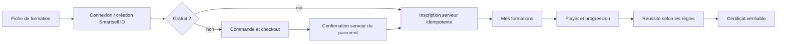

# Smartsell Academy — architecture LMS proposée

Statut : conception avant validation. Le catalogue existant de 13 formations et ses trois leçons d’aperçu par cours sont conservés ; ils ne sont pas déclarés complets ou certifiants par simple migration.

## Offre et structure pédagogique

Séparer deux axes : gratuit/payant et modalité (présentiel, live online, vidéo, cohorte, bootcamp, workshop, entreprise). Un cours peut avoir plusieurs sessions/cohortes sans dupliquer son programme.

Chaque formation possède titre, slug, descriptions courte/complète, cover, trailer, formateurs, tarif GNF, langue, catégorie, niveau, durée, prérequis, objectifs, règle de certification, date/capacité si session et statut éditorial. Les modifications significatives créent une nouvelle version ; une inscription conserve sa version de programme, son prix et les conditions acquises.

Hiérarchie : Formation → Modules ordonnés → Leçons ordonnées. Types de leçon : VIDEO, TEXT, PDF, DOWNLOAD, QUIZ, ASSIGNMENT, LIVE SESSION. Les aperçus publics sont explicitement marqués ; les ressources payantes ne sont pas exportées au build public.

## Inscription et entitlement

L’inscription gratuite n’ouvre aucun checkout. Une formation payante n’accorde aucun accès sur la seule page de retour du fournisseur. Capacité de cohorte, période d’accès et statut du cours sont vérifiés dans une transaction. Un nouvel appel ne crée pas une seconde inscription.

Les formats présentiels/live indiquent leur prochaine session, places et modalités ; achat et présence ne sont pas identiques à la complétion d’un cours vidéo. Les formations entreprises disposent d’un brief/devis et de cohortes affectées, sans faux achat individuel.

## Dashboard apprenant mobile-first

« Bonjour [prénom] », formations en cours, progression globale, prochaine leçon, formations terminées, certificats, résultats, téléchargements, commandes/paiements/factures et profil. La progression globale a une définition explicite (moyenne des cours actifs, par exemple), sans mélanger cours achetés et aperçu local.

Carte de cours : intitulé, couverture, format, formateur, dernière activité, pourcentage et bouton Reprendre. Mobile : une action principale par écran ; navigation des leçons repliable. Les données sont rattachées au compte, pas à un navigateur particulier.

## Player

Colonne de programme à gauche sur desktop ; contenu central ; navigation précédente/suivante et action Terminer adaptée au type. Sur téléphone, programme dans un drawer accessible et contenu prioritaire. Sauvegarde de position vidéo reprise après interruption ; sous-titres/transcription lorsque disponibles.

`lesson_started`, `lesson_completed`, `course_progress` et résultats de quiz sont enregistrés côté serveur. Le pourcentage est calculé à partir de leçons requises et d’états validés, pas d’un chiffre envoyé par le client. Un appel de progression est idempotent ; les événements répétés ne donnent pas des points supplémentaires.

Pour une leçon texte, une confirmation peut suffire selon la règle métier. Pour un quiz, une correction serveur est nécessaire. Pour un devoir ou une présence live, la validation suit sa règle spécifique. Une position vidéo déclarée par un navigateur ne constitue pas une preuve forte de présence ; ne pas promettre de surveillance inviolable.

## Quiz et devoirs

- Single choice, multiple choice, vrai/faux et réponse textuelle.
- Configuration : points, passing_score, essais, délai éventuel, feedback et politique de reprise.
- Les clés de correction sont privées. Le client soumet des réponses ; le serveur enregistre et calcule le score sur la bonne version.
- Réponse textuelle : critères explicites. Évaluation automatique uniquement si elle est déterministe et validée ; sinon correction par formateur affecté.
- Un devoir doit pouvoir rester « en attente de correction ». L’UI n’annonce pas 100 % ni certificat avant décision.
- Les essais soumis sont immuables ; une relecture laisse une trace plutôt que remplacer l’historique.

## Vidéos : VideoProvider

Contrat proposé : créer une session d’upload direct, lire l’état d’encodage, vérifier un callback, fournir les métadonnées, signer la lecture, retirer une ressource selon rétention. Implémentations prévues Bunny Stream, Mux et Cloudflare Stream ; un adaptateur de test en développement.

Le choix réel dépend du budget, de la qualité réseau, du sous-titrage, de la couverture et des conditions commerciales. Aucun fournisseur n’est activé par cet audit. Les IDs provider et la politique d’accès restent en base, les secrets au serveur. Supabase sert images/PDF/petits documents, pas inutilement les gros cours vidéo. Un trailer peut être public ; une leçon payante exige un jeton de lecture à durée courte. [Exemple officiel de lecture protégée](https://developers.cloudflare.com/stream/viewing-videos/securing-your-stream/).

## Certificats

Émission après réussite serveur : apprenant, titre/version de formation, formateur, date, numéro unique et ID public aléatoire. Le PDF inclut une URL/QR de vérification `/certificate/[id]`. L’endpoint public retourne le statut émis/révoqué, l’intitulé et les informations d’identité autorisées ; pas d’email, facture ou progression complète.

Un certificat est unique par inscription/règle d’émission, avec invalidation explicite et motif interne. Sa copie PDF reste privée sauf choix de partage. Une modification de cours ne réécrit pas rétroactivement le diplôme délivré. Le terme « certificat » ne prétend pas à une accréditation externe non validée.

## Admin Academy

Créer/dupliquer/modifier/archiver/restaurer un cours, organiser modules/leçons, ajouter ressources et vidéos, configurer quiz et prix, publier/dépublier, gérer catégories, formateurs, cohortes et sessions. Vue des apprenants avec nom, email/téléphone autorisés, inscription, état de paiement, progression, dernier accès et certificat ; filtres par cours, état, paiement et complétion.

Le nom d’un formateur public et son compte staff sont deux références distinctes. Un formateur affecté corrige ses apprenants ; il ne reçoit pas la lecture globale des paiements.

## Notifications et acceptation

Événements : compte créé, inscription confirmée, cours disponible, paiement confirmé, certificat prêt. Les emails pédagogiques et la newsletter ont des finalités distinctes. Les callbacks créent des notifications via une outbox idempotente ; un email en erreur ne supprime pas l’inscription.

Recette critique : un nouvel utilisateur s’inscrit, achète avec un provider sandbox, reçoit son enrollment, suit les leçons, passe les quiz et obtient un certificat vérifiable sans intervention. Ajouter le cas gratuit sans checkout et le cas devoir en attente. Ce scénario est une **exigence à construire et tester**, pas un parcours fonctionnel déjà livré.
