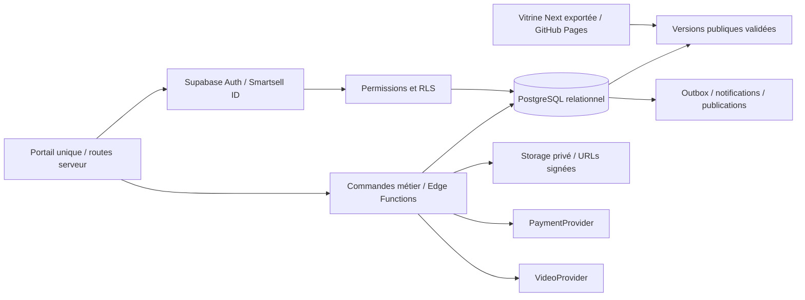

# Architecture Supabase V2 — modèle proposé

Statut : conception à valider ; aucune migration exécutée. Date : 19 octobre 2026.

## 1. Frontières et décision

Créer un projet Supabase **dédié à l’écosystème**, avec environnements distincts de développement/staging et production. Il n’utilise ni les tables ni les utilisateurs du produit Management. Supabase + admin personnalisé suffisent pour ce besoin : pas de CMS externe supplémentaire à ce stade.

Les lectures ordinaires utilisent la session et RLS. Les opérations privilégiées passent par des fonctions dédiées, bornées et auditées. Une clé secrète ne quitte jamais le serveur. La clé publique n’est pas une permission d’administration. [Supabase API keys](https://supabase.com/docs/guides/getting-started/api-keys).

## 2. Conventions communes

- UUID pour les entités, `created_at`, `updated_at`, `created_by`, `updated_by`, révision optimiste et `deleted_at` pour les contenus critiques.
- Séparer langue de l’interface, langue de formation et traduction éditoriale. Les champs FR/EN existants peuvent être migrés en JSONB localisé validé, ou en tables de traductions lorsque leur requêtage le justifie. Slugs historiques conservés ; slug alternatif explicite si nécessaire.
- Montants entiers avec code devise et unité explicite. GNF par défaut, sans présumer que chaque devise possède deux décimales. Jamais de `float` pour les montants.
- Horodatages en UTC (`timestamptz`), affichage métier `Africa/Conakry`. Les disponibilités récurrentes portent aussi le fuseau de leur lieu.
- Clés étrangères indexées, unicité des slugs par collection/locale active, ordre explicite et pagination. Les suppressions d’utilisateurs ne doivent pas effacer les pièces comptables nécessaires : anonymisation et règles de conservation à définir avant production.
- Les tables métier listées ci-dessous ont RLS et des grants minimaux. Les tables de secrets et réponses correctes sont hors schéma exposé.

## 3. Core, comptes et permissions

| Table                       | Fonction et relations                                                                                               |
| --------------------------- | ------------------------------------------------------------------------------------------------------------------- |
| `profiles`                  | `id = auth.users.id`, nom affiché, téléphone facultatif, langue, préférences ; aucun rôle modifiable dans ce profil |
| `roles`                     | Rôles métier stables et descriptifs                                                                                 |
| `permissions`               | Actions explicites : `agency.project.publish`, `academy.course.edit`, etc.                                          |
| `role_permissions`          | Liaison de chaque rôle à ses permissions                                                                            |
| `user_roles`                | Rôles cumulables, attribués par une opération privilégiée ; unicité utilisateur/rôle/périmètre                      |
| `audit_logs`                | Auteur, action, cible, horodatage, trace de requête ; append-only depuis opérations serveur, sans secrets           |
| `notifications`             | Destinataire, type, ressource, état lu/non lu ; données minimales                                                   |
| `notification_deliveries`   | Canal, statut, essais, erreur et clé d’idempotence                                                                  |
| `files`                     | Bucket, chemin immuable, MIME, taille, propriétaire, domaine, visibilité, crédit, alt et checksum                   |
| `content_versions`          | Révisions éditoriales, version de travail et référence publique ; payload validé par domaine                        |
| `publication_jobs`          | Cible, révision approuvée, date souhaitée, état de déploiement, erreur, tentative                                   |
| `outbox_events`             | Événements métier persistés dans la même transaction, dispatchés après commit                                       |
| `leads`                     | Demandes collectées avec consentement et source ; séparées des catalogues publics                                   |
| `orders`, `order_items`     | Commande et prix figé : formation ou réservation, quantité, taxe/remise éventuelle validée                          |
| `payments`                  | Paiement métier, bénéficiaire, fournisseur, statut, montant et devise                                               |
| `transactions`              | Tentatives et événements externes, identifiant fournisseur unique                                                   |
| `invoices`, `invoice_lines` | Facture émise, numéro unique, montants figés, références de commande ; corrections tracées                          |
| `payment_events`, `refunds` | Déduplication des webhooks et suivi des remboursements                                                              |

Détails des droits : [roles-permissions.md](roles-permissions.md). Aucun visiteur ne peut s’attribuer un rôle de staff à l’inscription.

## 4. Agency

| Table                     | Contenu                                                                                                                                          |
| ------------------------- | ------------------------------------------------------------------------------------------------------------------------------------------------ |
| `agency_projects`         | Client, titre/slug, année, secteur, catégories, présentation, challenge, solution, résultats validés, technologies, statut, mise en avant, ordre |
| `agency_services`         | Intitulé, description, livrables, ordre, version publique                                                                                        |
| `agency_project_services` | Liaison projets ↔ expertises                                                                                                                    |
| `agency_clients`          | Nom, logo, informations publiques autorisées ; contact commercial séparé                                                                         |
| `agency_team`             | Profils publiables et consentement ; ne pas confondre avec les comptes admin                                                                     |
| `agency_testimonials`     | Citation, auteur, client, preuve/autorisation interne, statut et ordre                                                                           |
| `agency_project_media`    | Référence `files` ou vidéo du provider, type, légende, alt, ordre                                                                                |
| `agency_pages`            | Textes administrables à propos, histoire, contact et blocs sélectionnés                                                                          |

Les six brandbooks, treize sites et trois séries sont importés comme projets typés, avec anciens slugs. Les films peuvent être rattachés à un projet et réutilisés dans Media sans recopier les fichiers. Les résultats absents restent vides ; aucun chiffre de performance n’est déduit d’une image.

## 5. Academy

| Table                        | Fonction                                                                                                                                   |
| ---------------------------- | ------------------------------------------------------------------------------------------------------------------------------------------ |
| `academy_courses`            | Catalogue, slug, titre, descriptions, cover, trailer, prix/accès, modalité, niveau, durée, langue, objectifs, prérequis, statut et version |
| `academy_categories`         | Taxonomie et ordre                                                                                                                         |
| `academy_instructors`        | Identité publique du formateur ; lien optionnel à `profiles`                                                                               |
| `academy_course_instructors` | Formateurs affectés à un cours et droits d’édition/correction                                                                              |
| `academy_modules`            | Modules ordonnés d’une version de formation                                                                                                |
| `academy_lessons`            | Métadonnées de leçon : module, type, titre, ordre, durée, aperçu public ou protégé                                                         |
| `academy_lesson_contents`    | Corps et ressources protégés, distincts des métadonnées publiques                                                                          |
| `academy_enrollments`        | Utilisateur/cours/version/cohorte, état, accès, commande liée ; unicité adaptée pour éviter le double enrollment                           |
| `academy_progress`           | Inscription/leçon, début, fin, position, état validé ; unicité inscription/leçon                                                           |
| `academy_quizzes`            | Configuration, seuil, nombre d’essais, politique de feedback                                                                               |
| `academy_questions`          | Énoncés et options sans correction secrète                                                                                                 |
| `private.quiz_answer_keys`   | Réponses/critères : non exposés à la Data API ; accès au service de correction uniquement                                                  |
| `academy_attempts`           | Essais soumis, réponses, score serveur, état et version du quiz                                                                            |
| `academy_assignments`        | Consignes et modalités des devoirs                                                                                                         |
| `academy_submissions`        | Dépôts privés, correcteur, statut et appréciation                                                                                          |
| `academy_certificates`       | Inscription, nom figé, cours/version, formateur, numéro unique, ID public non prévisible, émission et révocation                           |
| `academy_cohorts`            | Dates, capacité, formateurs et inscriptions d’une cohorte                                                                                  |
| `academy_sessions`           | Live/présentiel, date, capacité, lieu/lien protégé, présence                                                                               |
| `academy_downloads`          | Ressources autorisées et éventuels événements de téléchargement, sans URL privée permanente                                                |

Les objectifs pédagogiques complets et les quiz de certification seront validés avant la vente. Les cours existants ont trois leçons d’aperçu : leur import n’en fait pas automatiquement des programmes complets.

## 6. Media

`media_articles`, `media_categories`, `media_tags`, `media_article_tags`, `media_authors`, `media_events`, `media_article_media` et `media_newsletter_subscriptions`.

Article : titre/slug, excerpt, document riche structuré, cover, auteur, catégories/tags, dates d’édition et publication, durée de lecture calculée, SEO/OG, statut, mise en Une, version publique. Événement : titre/slug, description, dates, fuseau, lieu, cover, organisateur, URL, catégorie et statut.

Les brouillons et révisions ne partagent pas une projection publique trop large. Un article programmé ne devient lisible qu’après la transition serveur et publication de sa révision approuvée. La vitrine statique peut présenter un délai de build, distinct de la date demandée.

## 7. Studios

`studio_spaces`, `studio_services`, `studio_packages`, `studio_package_services`, `studio_addons`, `studio_package_addons`, `studio_resources`, `studio_availability`, `studio_blackouts`, `studio_bookings`, `studio_booking_addons`, `studio_resource_allocations`, `studio_gallery`.

- Espace/ressource : capacité, équipement, fuseau, staff requis si cette capacité doit être réservée.
- Package : prix GNF, durée, durée de préparation/rangement, services, staff, équipements et livrables.
- Disponibilité : règle récurrente + exceptions ; ne constitue pas une réservation.
- Booking : utilisateur, espace, créneau, statut, montant/arrhes, commande, expiration du hold, coordonnées et notes limitées.
- Allocation : ressource + période réservée, incluant les buffers ; bookings, holds et blocages partagent la même règle anti-chevauchement.

Une contrainte d’exclusion PostgreSQL sur une plage temporelle et la ressource empêche deux allocations actives concurrentes. Les périodes utilisent `[début, fin)` pour permettre deux séances adjacentes lorsque les buffers l’autorisent. [Documentation PostgreSQL](https://www.postgresql.org/docs/current/rangetypes.html).

## 8. Labs / Produits

Conserver une collection `products` et ses médias, textes et liens. Elle reste administrable dans un module secondaire de l’admin. Aucun nouveau cinquième univers dans la navigation publique. Aucun accès privilégié au produit Management n’est induit par cette collection.

## 9. Commandes serveur essentielles

| Commande proposée                   | Vérifications et effets atomiques                                                                           |
| ----------------------------------- | ----------------------------------------------------------------------------------------------------------- |
| `enroll-free`                       | Session, cours gratuit publié, éventuelle capacité ; inscription unique + événement notification            |
| `create-checkout`                   | Prix lu en base, commande figée, accès et capacité ; clé d’idempotence                                      |
| `payment-webhook`                   | Signature, montant/devise/référence et événement unique ; paiement + entitlement/booking + facture/outbox   |
| `complete-lesson`                   | Propriétaire, inscription active, prérequis, type de leçon ; pas de complétion arbitraire d’un autre compte |
| `submit-quiz`                       | Version, essais, correction serveur et score ; aucune correction secrète dans la réponse                    |
| `issue-certificate`                 | Réussite calculée côté serveur et absence de doublon ; certificat + événement                               |
| `video-playback-token`              | Accès au cours avant signature de lecture temporaire                                                        |
| `request-download`                  | Propriétaire/inscription/permission avant URL signée                                                        |
| `hold-booking`                      | Horaire, package, ressources, buffers, capacité ; acquisition atomique ou conflit                           |
| `confirm/cancel/reschedule-booking` | Permission, état et politique de paiement ; allocations et outbox dans la transaction                       |
| `publish-content`                   | Permission par domaine, version attendue, schéma validé, journal et job de publication                      |
| `assign-role`                       | Super-admin autorisé et audit ; aucun rôle depuis les métadonnées éditables du profil                       |

Une action financière ou certifiante ne se réduit pas à un `update` direct du navigateur. Les fonctions qui utilisent des droits élevés doivent refaire ces contrôles même si RLS est activé. [Supabase RLS](https://supabase.com/docs/guides/database/postgres/row-level-security).

## 10. Storage et streaming

| Bucket            | Visibilité initiale                                             | Usage                                                     |
| ----------------- | --------------------------------------------------------------- | --------------------------------------------------------- |
| `public-media`    | Public                                                          | Illustrations générales déjà approuvées                   |
| `agency-media`    | Privé à l’import ; copie publique explicite lors de publication | Projets et brandbooks                                     |
| `academy-assets`  | Public uniquement pour covers/trailers approuvés                | Catalogue public                                          |
| `academy-private` | Privé                                                           | PDF payants, devoirs, téléchargements                     |
| `media-images`    | Privé en brouillon ; copie publique contrôlée                   | Covers, images d’articles et événements                   |
| `studio-assets`   | Public pour catalogue approuvé                                  | Espaces et galerie ; aucune pièce client privée           |
| `certificates`    | Privé                                                           | Documents téléchargeables ; vérification publique séparée |

Un bucket est public ou privé au niveau du bucket. La promotion signifie une **copie approuvée** vers le bucket public adapté, pas l’exposition d’un dossier privé dans le même bucket. En phase initiale, `public-media` peut porter les copies publiques par préfixe de domaine ; les références `files` gardent l’original et la copie.

Les URLs signées ont une courte durée adaptée à l’usage ; elles restent valables jusqu’à expiration, même après changement de session. Ne pas les mettre dans des sitemaps, HTML public ou logs. [Supabase Storage](https://supabase.com/docs/guides/storage/serving/downloads).

Les grandes vidéos pédagogiques restent chez VideoProvider (Bunny/Mux/Cloudflare). Supabase conserve les IDs, l’état d’encodage et la règle d’accès. Les sources et corrigés ne sont pas inclus dans les exports GitHub Pages.

## 11. Publication, audit et suppression

Le brouillon est une révision distincte de `published_version_id`. Modifier un article déjà publié ne retire pas sa version publique. Archiver/dépublier exige une action explicite, journalisée. `deleted_at` permet restauration ; purge éventuelle après politique de rétention et vérification des liens, jamais à l’action ordinaire « supprimer ».

Les logs stockent acteur, action, cible et identifiant de corrélation ; pas de mot de passe, token, carte, URL signée ou corps intégral d’un devoir. Les jobs de publication et notifications sont rejouables sans duplication grâce à leurs clés uniques.

## 12. Migration et activation après validation

1. Inventorier le schéma distant réel et les migrations appliquées. Ne jamais supposer que la migration locale n’a pas été appliquée ailleurs.
2. Sauvegarder la base si elle existe, le catalogue source, les médias et les brouillons locaux nécessaires.
3. Créer des migrations **additives et versionnées**, ainsi qu’un seed de développement fictif ; ne pas réécrire une migration appliquée.
4. Importer via script idempotent avec `legacy_id/legacy_slug` et journal d’import. Comparer nombres, traductions, routes et références de médias.
5. Tester RLS/RPC, restauration et projection publique en staging.
6. Basculer un domaine à la fois avec feature flag ; une source de vérité par domaine, pas de double écriture durable.
7. Garder un rollback applicatif et une procédure de reprise des nouvelles transactions. Les sauvegardes et restaurations de données sont distinctes du rollback du code.

Le schéma détaillé et les migrations SQL exécutables seront livrés en phase 2 après validation de ce modèle. Les tables génériques `ecosystem_*` du chantier interrompu ne sont pas promues automatiquement en schéma final.
