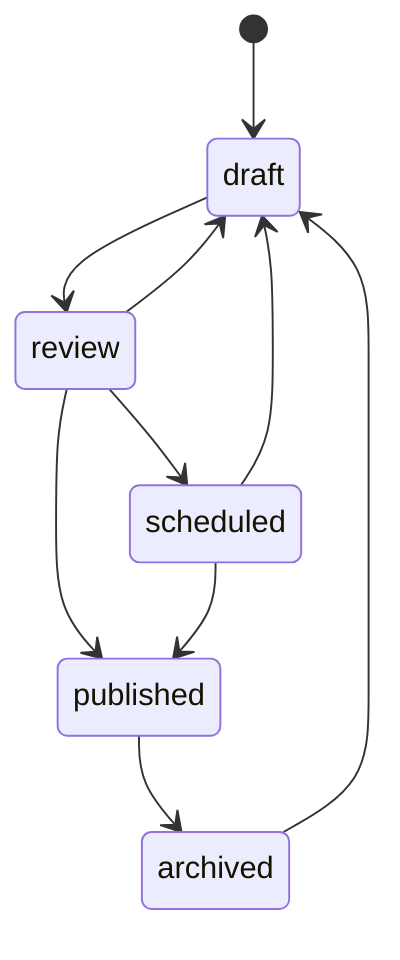

# Smartsell Media — CMS et média V2

Statut : proposition à valider. Conserver les vingt articles, leurs slugs, les dix-huit films et les rubriques existantes. Les catégories Digital et Events complètent la navigation ; elles ne remplacent pas les anciennes pages Marketing, Creative ou Opinions.

## Modèle éditorial

Article : title, slug, excerpt, document riche, cover/alt/crédit, auteur, rubrique, tags, dates, reading time, SEO title/description, OpenGraph image, état, featured, ordre et version. Événement : nom/slug, description, dates/fuseau, lieu, cover, organisateur, URL, catégorie et état.

Une rubrique porte une définition éditoriale et un ordre. Les tags sont des liaisons, pas une chaîne libre impossible à filtrer. Les auteurs disposent d’un profil public et, si nécessaire, d’un compte d’écriture séparément autorisé.

## Éditeur riche

Choisir un éditeur fondé sur un document JSON structuré (candidat : Tiptap/ProseMirror, à valider à l’implémentation). Types autorisés : titres, paragraphes, liens, images, citations, listes, embeds et vidéos. Barre d’outils accessible, aperçu desktop/mobile, lien de brouillon sécurisé et autosave avec conflit explicite.

Le rendu public utilise une liste fermée de nœuds. Les liens, embeds et URLs de médias sont validés ; pas de script, handler inline ou iframe arbitraire. Images et vidéos gardent alt/crédit et format. La durée de lecture est calculée à partir du texte, avec possibilité de règle éditoriale documentée.

## États et révisions

Une nouvelle révision de travail peut être draft alors que la version précédente reste publique. Dépublier et archiver sont des actions explicites. Pour une date future : `publish_at` en UTC, affichée dans le fuseau choisi. Un job serveur vérifie permission, statut et révision, publie, puis déclenche le déploiement ou invalide le cache.

Sur GitHub Pages, distinguer « version publiée en base » et « page déployée » ; retenter et signaler l’échec. Une publication exactement à la minute nécessite une lecture publique dynamique ou un hébergement serveur adapté. Une simple comparaison de date dans le navigateur n’est pas un mécanisme de programmation fiable.

## Admin Media

Liste paginée, recherche, filtres état/auteur/rubrique/date, actions en masse, duplication, prévisualisation et Une. `media_author` écrit et soumet ses brouillons ; `media_editor` relit, publie, programme et archive. Révision et déploiement sont visibles dans l’historique.

Le CRUD d’événements partage médias, catégories, dates et SEO, avec schéma Event. La page Événements distingue à venir et passés. Les interviews peuvent rester des articles/vidéos catégorisés plutôt qu’un quatrième CMS distinct.

## Médias, newsletter et mesure

Les imports de brouillon restent privés ; une copie explicitement approuvée devient publique. Les clips existants peuvent rester des fichiers publics si leurs droits le permettent ; les grandes vidéos à venir utilisent VideoProvider.

Newsletter : consentement explicite, confirmation email et désabonnement. Aucun abonné fictif ni envoi activé sans fournisseur configuré. Les vues d’articles et catégories sont collectées selon la politique retenue ; la recherche respecte langue et état publié. Une référence au nombre d’articles ne remplace pas une mesure d’audience.

## Acceptation

Créer un article, ajouter titre/citation/liste/lien/image/vidéo, prévisualiser, soumettre, publier puis modifier sans retirer l’ancienne version. Programmer un autre article et constater son job/deploiement ; archiver puis restaurer. Un rôle Media ne peut pas éditer Academy. Vérifier absence du brouillon dans recherche, sitemap, HTML et Data API anonyme.
