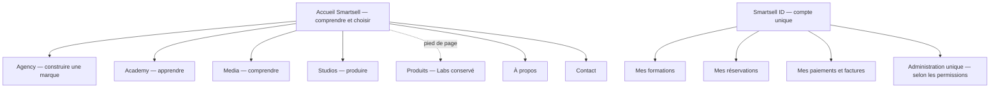

# Architecture d’information V2 — proposition à valider

Date : 19 octobre 2026. Aucun changement de route n’est exécuté par ce document.

## Une marque, quatre portes, un espace de compte

La navigation principale utilise `Agency · Academy · Media · Studios · À propos · Contact`. Logo vers l’accueil. La recherche et le compte sont des utilitaires discrets ; le compte n’affiche aucun faux statut connecté avant l’activation. Sur mobile, ces liens passent dans un menu accessible. Pas de mega-menu de tous les services sur la homepage.

Le pied de page propose Produits, carrières, contact, confidentialité, conditions, accessibilité et langue. La suppression de Labs comme porte principale ne supprime pas Labs du produit.

## Limites entre les espaces

| Espace         | Mission                                  | Information prioritaire                               | Ce qui reste ailleurs                               |
| -------------- | ---------------------------------------- | ----------------------------------------------------- | --------------------------------------------------- |
| Accueil maison | Comprendre Smartsell, choisir un univers | Quatre cartes, sélection de travaux, preuves, contact | Catalogues, prix détaillés, player, admin           |
| Agency         | Présenter l’agence et convaincre         | Services, projets et contact                          | Paiements Academy, booking interne                  |
| Academy public | Trouver une formation adaptée            | Format, formateur, programme, prix, dates, prérequis  | Leçons protégées, notes privées, paiements internes |
| Media public   | Lire et explorer                         | Une, rubriques, articles, événements                  | Édition, corrections et brouillons                  |
| Studios public | Choisir un service et une séance         | Espaces, offres, disponibilité calculée, booking      | Planning interne, données des autres clients        |
| Produits       | Découvrir les outils Smartsell           | Management, Kuma, Obtura, Garant et leurs vrais liens | Nouvelle inscription implicite à Management         |
| Compte         | Réaliser et suivre ses actions           | Apprentissage, réservations, factures, profil         | Configuration globale du produit                    |
| Admin unique   | Gérer les quatre domaines                | Modules visibles selon rôles ; outils communs         | Quatre back-offices séparés                         |

## Navigation par univers

- Agency : Agence, Services, Réalisations, Collectif, Contact. À propos/histoire et carrières restent accessibles depuis les pages adaptées.
- Academy : Formations, Entreprises, Formateurs, Agenda, Mon apprentissage. Filtres par format/niveau/thème ; pas de menu listant tous les cours.
- Media : À la Une, Derniers articles, Tech, IA, Digital, Business, Plus de rubriques, Événements. Le détail des rubriques ne surcharge pas la maison.
- Studios : Espaces, Services, Packages, Galerie, Réserver. Contact/FAQ dans les compléments de navigation.

## Répartition physique recommandée

Conserver les six applications publiques et les packages partagés. Ajouter, après validation, **une application `portal` commune** aux comptes, à l’admin et aux parcours privés, sur un hébergement supportant les routes serveur. L’origine de ce portail est à choisir ; aucun nom de domaine n’est acquis ou configuré à cette étape.

La vitrine reste sur GitHub Pages. Le portail utilise le même Supabase Auth : **une identité et un compte**, sans prétendre que le localStorage d’auth est partagé entre domaines. La connexion se déroule sur l’origine du portail ; les pages publiques y dirigent leurs CTA. Les flux de retour utilisent une liste de destinations autorisées et PKCE, jamais de secret dans l’URL.

Ce choix permet les routes dynamiques de certificat, les liens profonds du LMS et une politique de cache privée correcte. Alternative temporaire sur GitHub Pages : shells statiques et IDs en query string ; cette alternative ne satisfait pas à elle seule toutes les routes finales du brief. Voir [sitemap-v2.md](sitemap-v2.md).

GitHub Pages est un hébergement statique ; le portail et les fonctions Supabase portent les opérations serveur. [Documentation GitHub](https://docs.github.com/en/pages/getting-started-with-github-pages/what-is-github-pages).

## Recherche

Conserver l’interface de recherche existante et la faire évoluer vers un index public unifié : formations, articles, projets et packages publiés. Aucun nom d’apprenant, facture, demande privée, corps de leçon payante ou brouillon dans cet index. Langue, type, catégorie, pagination et destinations de repli explicites.

La palette de commandes de l’admin recherche les ressources autorisées et propose des actions selon permissions. Un résultat hors périmètre ne doit pas apparaître, même si son URL est connue.

## Contenus déplacés depuis l’accueil

La correspondance détaillée figure dans [homepage-v2-proposal.md](homepage-v2-proposal.md). Avant toute suppression d’une section, son contenu doit être retrouvé dans l’univers cible ou conservé dans l’archive source. Les données de la homepage seront une sélection éditoriale de contenus publiés, pas une seconde copie des catalogues.
