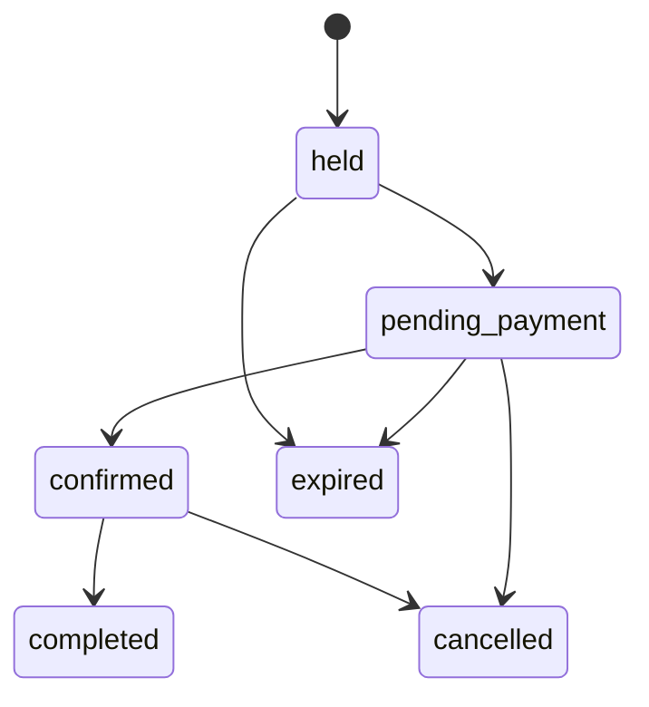

# Smartsell Studios — réservation V2

Statut : conception à valider. Les espaces, six packs, galerie et pages actuels sont conservés. Le parcours WhatsApp actuel est une demande ; il ne constitue ni un créneau bloqué ni un paiement.

## Catalogue et offre

Services : photo shoot, video shoot, podcast, interview, émission, content creator, product shoot, corporate interview, livestream, training/workshop. Un service peut utiliser plusieurs espaces/packages ; éviter un composant spécifique par combinaison.

Espace : description, photos, capacité, équipement, fuseau et règles d’exploitation. Package : nom, description, prix GNF validé, durée, services, staff, équipements, livrables, add-ons compatibles, temps de préparation/rangement et acompte. Les six packs actuels n’apportent pas à eux seuls des prix de vente validés : aucun tarif n’est inventé pendant l’import.

## Parcours client

Service → package → date → heure/durée → options → coordonnées/connexion Smartsell ID → récapitulatif → paiement/acompte → confirmation. La disponibilité et le montant sont recalculés par le serveur ; les champs du navigateur ne font pas foi.

Sur mobile : étapes courtes, sélection tactile des créneaux, résumé du prix et conditions avant paiement, reprise de la saisie sans stocker des données client sensibles dans un export public. Les créneaux indisponibles restent explicites ; pas de sélection d’un horaire non vérifié.

## Machine d’état

Le paiement possède sa propre machine d’état. Une réservation peut être confirmée avec acompte et solde dû selon la politique ; « réservation confirmée » n’implique pas forcément « totalement payée ».

Une confirmation manuelle reste possible pour les réservations autorisées hors ligne, avec rôle, motif et audit. Elle n’est pas présentée comme une preuve de paiement automatique.

## Anti-double-booking

1. Lire le package, les disponibilités, fermetures, buffers, ressources et capacité depuis la base.
2. Dans une transaction, verrouiller les ressources concernées dans un ordre déterministe.
3. Expirer les anciens holds concernés, créer le booking et ses allocations, ou refuser avec conflit.
4. Une exclusion PostgreSQL sur ressource/période empêche le chevauchement d’allocations actives, même entre requêtes simultanées.
5. Lors d’un webhook, verrouiller booking/paiement et confirmer une seule fois. Le solde et l’acompte sont calculés côté serveur.

Les blocages opérateur et indisponibilités staff/équipement partagent le mécanisme d’allocation lorsqu’ils représentent une capacité exclusive. Une disponibilité affichée quelques secondes plus tôt ne garantit jamais l’acquisition.

Expiration : stocker `hold_expires_at` et faire passer explicitement les allocations à un état libéré via job et commandes de réservation. Ne pas utiliser `now()` dans le prédicat d’un index de contrainte. Durée de hold proposée : 10–15 minutes, à valider selon les délais du provider de paiement.

Paiement tardif après expiration : tenter une réacquisition atomique ; sinon ouvrir une exception et un traitement de remboursement/report selon la politique, sans surbooker ni ignorer un encaissement. Source technique : [contraintes de plages PostgreSQL](https://www.postgresql.org/docs/current/rangetypes.html).

## Admin Studios

Gérer espaces, services, packages, tarifs, options, plages d’ouverture et exceptions. Calendrier jour/semaine/mois avec fuseau affiché, filtres espace/statut, ressources et informations de paiement limitées au périmètre.

Confirmer, annuler, déplacer ou bloquer un créneau passe par une commande serveur. Déplacer réserve la nouvelle allocation et libère l’ancienne dans une transaction ; en cas de conflit, l’ancienne réservation reste intacte. Les modifications de prix ultérieures ne changent pas le devis déjà accepté.

Annulation : conditions, délai, acompte conservé/remboursable et frais doivent être définis avant vente. Notifier le client après commit ; une notification en erreur ne remet pas la réservation dans l’état précédent.

## Tests de sortie

Deux comptes tentent simultanément le même espace sur des périodes qui se chevauchent : une seule allocation réussit. Tester aussi créneaux adjacents, buffer, changement de durée, hold expiré, blocage opérateur concurrent, double webhook, paiement tardif et déplacement conflictuel. Le client A ne lit pas le booking de B ; un studio_manager ne publie pas un article Media.
